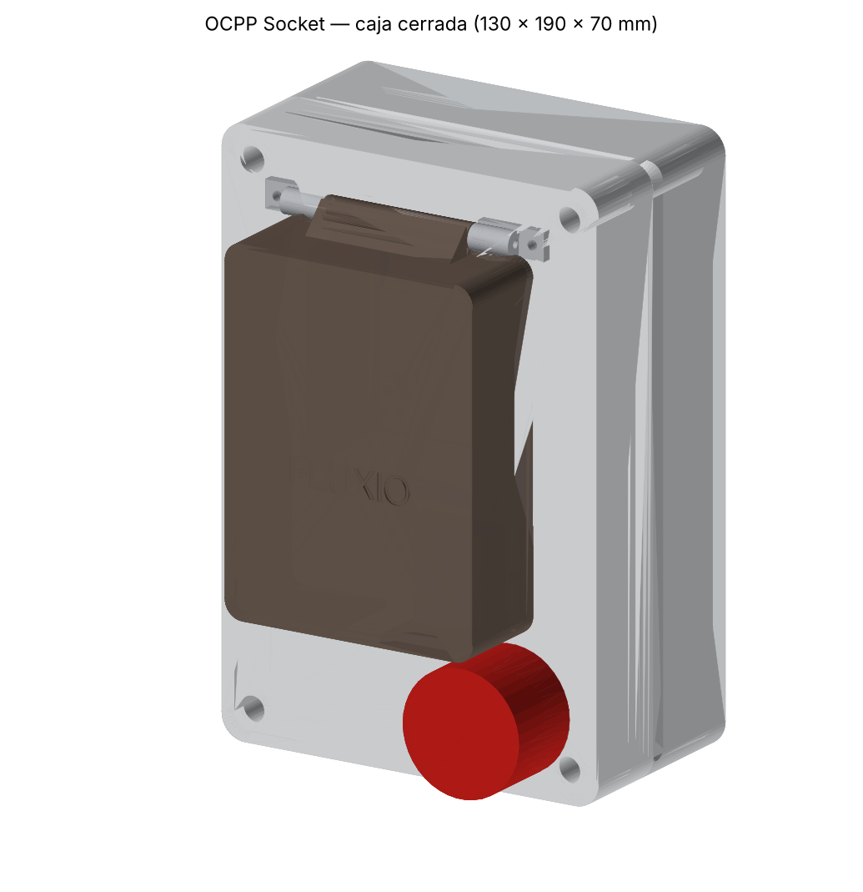
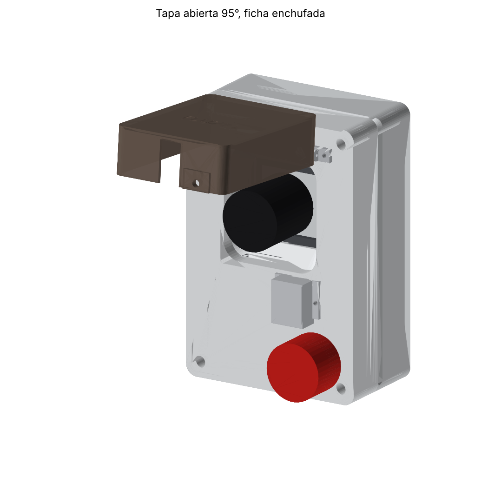
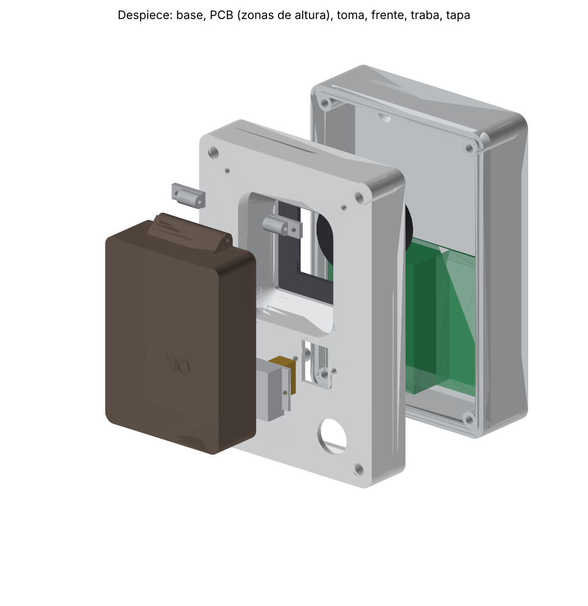
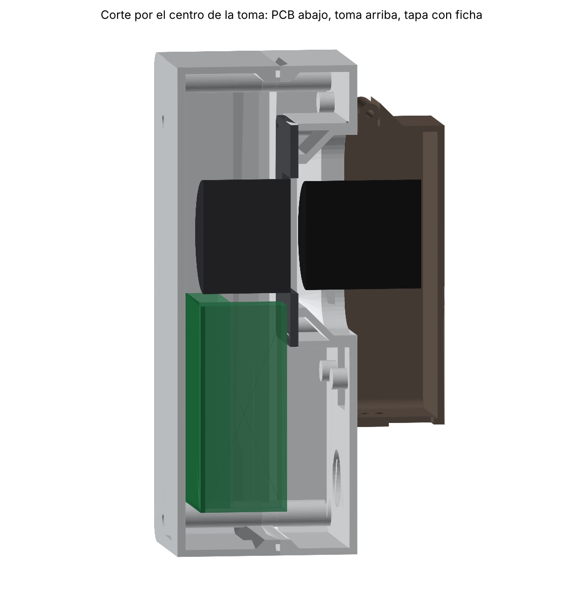

# Caja del OCPP Socket (CAD como código)

Caja propia según el boceto de JB: frente con toma empotrada, **tapa con bisagra que cierra con la
ficha enchufada** (el cable sale por una muesca abajo), pulsador RGB en el lateral izquierdo y botón de
emergencia en el frente. Decisión: [0011](../../decisions/0011-caja-propia-impresa.md).

Todo sale de dos archivos: `params.py` (cada medida, con las que vienen de piezas reales marcadas
**CONFIRM**) y `enclosure.py` (la geometría, build123d). `mechanical/tests/test_enclosure.py` verifica
22 reglas físicas en cada cambio.

| Cerrada | Tapa abierta con ficha | Despiece | Corte |
|---|---|---|---|
|  |  |  |  |

## Comandos

```bash
pip install build123d trimesh matplotlib pyyaml pytest
make mech          # exporta STL (ya orientados para imprimir) + STEP del conjunto a out/, y regenera renders/
make mech-test     # los 22 chequeos (interferencias, holguras, junta, traba, cama, masa vs BOM)
```

CI corre los tests y sube los STL/STEP como artefacto de cada build.

## Piezas e impresión (FDM, sin soportes)

| Pieza | Cant. | Orientación en la cama | Tamaño en cama (mm) | Notas |
|---|---|---|---|---|
| `base` | 1 | fondo abajo | 130 × 190 × 40 | Standoffs PCB, ranura de junta, prensacable M20 (agujero en gota), agujero PB1 (en gota) |
| `cover` | 1 | **frente abajo** | 130 × 190 × 30 | El pozo de la toma es un embudo a 45°: imprime sin soportes. Ceja interna con chaflán a 45° |
| `lid` | 1 | frente abajo | 85 × 127 × 34 | Escuadra a 45° bajo la bisagra. Logo FLUXIO grabado 0.6 mm |
| `hinge_bracket` | **2** | placa abajo | 23 × 9 × 9 | El mismo STL dos veces (el izquierdo es el derecho girado 180°) |
| `lock_housing` | 1 | lado abierto abajo | 34 × 33 × 14 | Solenoide + sensor Hall; el pistón sale hacia abajo (no entra agua) |
| `socket_insert` | 1 | plana | 80 × 86 × 3 | Adaptador para la toma elegida (decisión 0010); se atornilla desde adentro |

Material: **ASA** (exterior, UV). PETG sirve para prototipos de banco. Para la tapa, PETG translúcido
da el efecto "ahumado" del boceto; en inyección sería PC ahumado.
Perfil sugerido: boquilla 0.4, capa 0.2, 5 perímetros, 30 % gyroid, 5 capas sup/inf.
Masa impresa ≈ 367 g (≈ USD 8 de filamento).

## Tornillería y sellos (BOM: `BOX-HW`)

| Ítem | Cant. | Dónde |
|---|---|---|
| Inserto termofijado M4 (Ø5.6 × 9) | 4 | Esquinas de la base (tornillos del frente) |
| Inserto termofijado M3 corto (Ø4.0 × 5.5) | 12 | 4 standoffs PCB, 4 postes de la placa de toma, 2 caja de traba, 2 bisagras |
| Tornillo M4 × 16 cabeza cilíndrica | 4 | Frente → base (en contrafrente, dentro de la junta) |
| Tornillo M3 × 6 / × 8 | 12 | PCB, placa de toma, traba, bisagras |
| Cordón EPDM/silicona Ø2.4 mm | ~620 mm | Ranura base/frente (25 % de compresión) |
| Pasador acero Ø3 × 80 (o tornillo M3 × 80 + tuerca) | 1 | Bisagra |
| Imán neodimio Ø6 × 3 | 1 | Tapa, frente al sensor Hall |
| Prensacable M20 (cable Ø6–12) | 1 | Entrada de red, abajo |
| Tarugos + tornillos Ø4–5 | 4 | Fijación a pared (avellanados desde adentro) |

## Armado

1. Insertos termofijados en base, frente y postes del pozo.
2. Toma en la placa adaptadora → placa contra la parte trasera del pozo, desde adentro, con su junta.
3. Solenoide + Hall en la caja de traba → caja atornillada al frente (2 × M3) con junta.
4. Bisagras al frente (2 × M3), tapa con el pasador.
5. Base a la pared (4 tornillos), PCB en los standoffs, cableado: red por el prensacable a TB1,
   faston a la toma, NTC, traba, pulsador, botón de emergencia.
6. Cordón en la ranura, frente con 4 × M4.

## Qué hay que confirmar con las piezas reales (CONFIRM en params.py)

- **Toma** (decisión 0010): recorte de la placa, envolvente del cuerpo (Ø44 × 34 asumido).
- **Botón de emergencia**: profundidad del bloque de contactos (40 mm asumido). Si es más largo,
  el test `test_estop_clears_pcb_and_base` va a fallar: es el que protege la zona baja de la PCB.
- **Solenoide**: cuerpo 12 × 20 × 11, carrera 4, pistón cortado a 4.8 mm de protrusión.
- **Pulsador RGB QN12**: largo del cuerpo detrás del panel (20 mm asumido).
- **Ficha del cargador Mode 2**: Ø42 × 45 de protrusión asumido; la tapa deja 3 mm de holgura.
- **Insertos y cordón**: diámetros de agujero según el proveedor.

## Pendientes conocidos

- Masa: la caja impresa (~367 g) deja a rev B en 728 g contra un presupuesto de 650 g → decisión de JB.
- El pozo de la toma drena por el embudo; el tramo recto inferior (9 mm) es horizontal: evaluar 3° de
  pendiente si en el ensayo de lluvia queda agua.
- Tope de apertura de la tapa: hoy abre libre hasta ~100°; agregar tope si molesta.
- Ensayos IP (IEC 60529) e hilo incandescente (docs/003) sobre la caja impresa en ASA.
